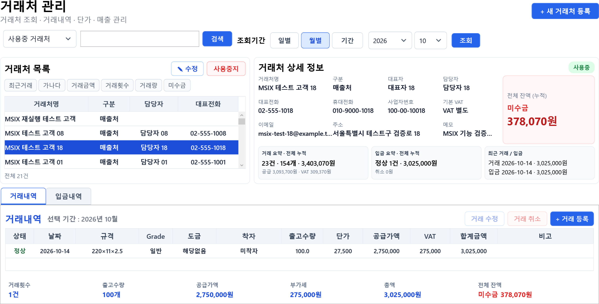
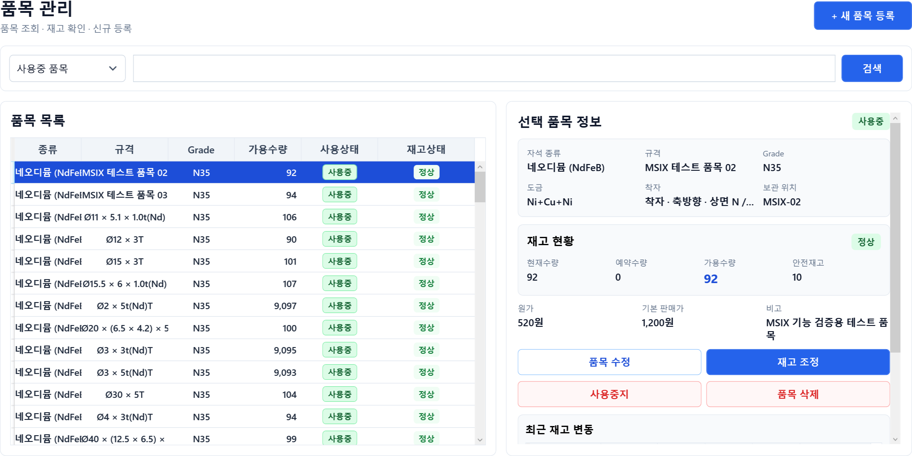
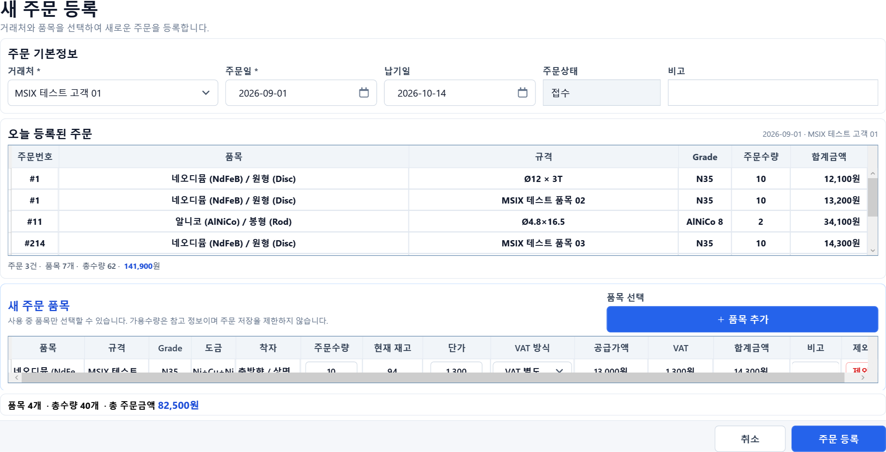
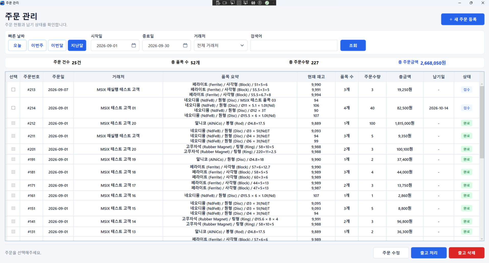
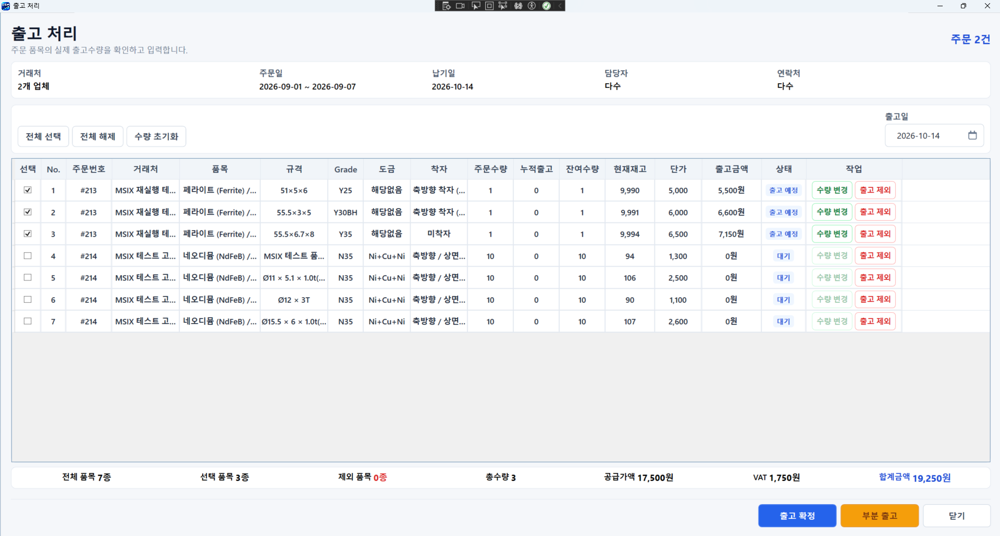
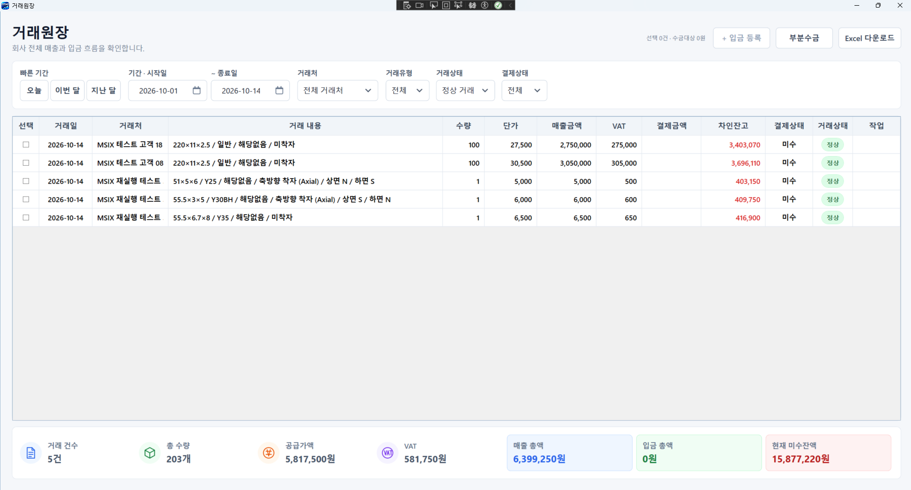

# DSM Manager

> 제조·유통 현장의 주문, 납품, 재고, 매출과 미수금을 한 흐름으로 관리하는 Windows 업무 프로그램

**C# · WPF · SQLite · Entity Framework Core · MSIX · Microsoft Store 배포**

[Microsoft Store에서 DSM Manager 보기](https://apps.microsoft.com/detail/9PDSRZCH9X41)

[포트폴리오 PDF 보기](portfolio/DSM_Manager_외주개발_포트폴리오.pdf) · [편집 가능한 PowerPoint 받기](portfolio/DSM_Manager_외주개발_포트폴리오.pptx)

## 프로젝트 소개

DSM Manager는 소규모 제조·유통업체의 거래처, 품목, 주문, 출고, 매입, 재고, 거래내역을 연결해 관리하도록 개발한 Windows 데스크톱 애플리케이션입니다. 실제 업무 흐름을 기준으로 화면과 데이터를 설계하고, 사용자 피드백을 반영해 가독성과 입력 편의성을 개선했습니다.

이 저장소는 외주개발 포트폴리오 공개용입니다. 전체 소스코드는 포함하지 않으며, 아래 화면의 거래처명과 수치는 공개용 데모 데이터입니다.

## 주요 기능

### 1. 거래처 및 품목 관리

- 매입처·매출처 구분, 담당자와 연락처, 사용 상태 관리
- 품목별 규격·등급·단가와 현재 재고 확인
- 거래처별 거래내역과 미수금 현황을 한 화면에서 확인

### 2. 주문 및 출고 관리

- 한 주문에 여러 품목을 등록하고 수량·단가·VAT·총금액을 즉시 계산
- 주문수량, 누적출고, 잔여수량과 현재재고를 함께 확인
- 전체출고와 부분출고를 지원하고 음수 재고와 중복 출고를 방지

### 3. 거래내역 및 미수금 관리

- 거래별 공급가액, VAT, 매출금액과 거래에 배분된 입금액 관리
- 미수·부분수금·결제완료 상태와 현재 받을 금액 확인
- 거래처·기간·결제상태 조건으로 조회하고 Excel로 내보내기

### 4. 기타 주요 기능

- 매입·입고·재고를 연결하고 취소 시 관련 수량과 데이터를 함께 복구
- 출고·매입 취소 사유와 변경 이력 보존
- 주문·출고·매입·재고 등 연결 업무의 데이터 일관성 보호
- Windows 100~175% DPI 및 다양한 화면 크기 대응
- MSIX 패키징과 Microsoft Store 배포

## 현장에서 해결하는 문제

| 기존 업무의 불편 | DSM Manager의 적용 방식 |
|---|---|
| 여러 Excel 파일에 거래와 재고가 분산됨 | 거래처·품목·주문·출고·매입·재고를 하나의 흐름으로 연결 |
| 부분출고 후 잔여수량을 수기로 계산함 | 누적출고와 잔여수량을 자동 계산하고 현재재고와 함께 검증 |
| 매출과 입금 기록이 분리되어 미수금 확인이 늦음 | 거래별 입금 배분과 결제상태를 연결해 미수금 현황을 즉시 확인 |
| 취소 처리 후 재고나 원장이 맞지 않음 | 취소 시 재고와 관련 데이터를 함께 복구하고 변경 이력을 보존 |

## 개발 및 수행 범위

| 구분 | 적용 내용 |
|---|---|
| 요구사항·업무 분석 | 실제 업무 흐름 정리, 데이터 및 화면 구조 설계 |
| Windows 애플리케이션 | C#, WPF/XAML 기반 데스크톱 UI 개발 |
| 데이터 | SQLite, Entity Framework Core 기반 저장·조회·일관성 처리 |
| 사용성 | 고DPI 및 다양한 화면 크기 대응, 입력·조회 화면 개선 |
| 배포 | MSIX 패키징, Microsoft Store 등록 및 배포 경험 |

## 적용 가능한 외주개발 분야

- 제조·유통 주문·납품·재고 관리
- 거래처·매출·수금·미수금 관리
- 매입·입고·재고 연동
- 기존 Excel 장부의 Windows 업무 프로그램 전환
- 기존 WPF 프로그램의 고DPI·화면 개선
- MSIX 및 Microsoft Store 배포

### 추가 개발 가능 영역

다중 PC, 클라우드 동기화, 사용자 권한, 바코드, 자동 백업은 고객의 운영 환경과 보안 요구사항을 확인한 뒤 별도로 설계할 수 있습니다. 현재 구현된 기능으로 오해되지 않도록 기본 제공 범위와 구분합니다.

---

본 저장소는 DSM Manager의 화면과 수행 역량을 소개하기 위한 공개 포트폴리오입니다. 프로그램 전체 소스코드와 실제 고객 데이터는 공개하지 않습니다.
